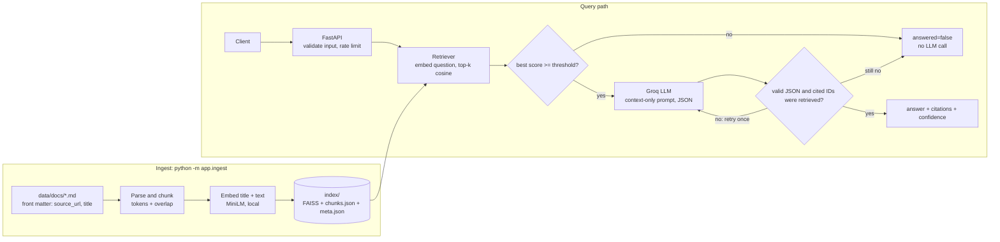

# CiteDocs

A small retrieval-augmented generation (RAG) service that answers questions about a set of product-documentation pages. Every answer cites the pages it came from, and when the documentation does not support an answer, the service says **"I don't know based on the provided documentation"** instead of guessing.

It includes an evaluation harness that measures retrieval and citation accuracy, so claims about quality come from numbers the script prints.

## Why this exists

Documentation assistants fail in two ways: they invent answers, and they give answers nobody can check. CiteDocs is built around the opposite rules:

- **Grounded:** the model only sees retrieved documentation chunks and is told to use nothing else.
- **Cited:** every answer lists the pages it relied on, and citations that point to chunks that were not retrieved are rejected.
- **Honest:** if the best match is not similar enough, the service answers "I don't know" **without calling the LLM**.
- **Measured:** `python -m eval.run` reports hit rate, citation accuracy, "I don't know" accuracy and latency on a labelled question set.

## Status

| Area | State |
|---|---|
| Config, ingestion, retrieval | Done |
| LLM layer and API (`/ask`, `/summarize`, `/sources`, `/health`) | Done |
| Offline test suite and linting | Done |
| Evaluation harness | Done; results depend on the docs you ingest (see [Evaluation](#evaluation)) |
| Dockerfile and Docker Compose | Planned |
| CI/CD, CodeQL, Dependabot | Planned |

## Architecture



**Ingestion** reads local `.md` / `.txt` files only (no scraping), splits each page into overlapping token windows, embeds each chunk locally and writes a FAISS index to `./index/`.

**Querying** embeds the question, finds the top-k chunks by cosine similarity and compares the best score with a threshold. Below it, the service returns `answered=false`. Above it, the chunks go to Groq with a prompt that restricts the answer to that context and requires JSON naming the chunk IDs used. The reply is validated with Pydantic, and its chunk IDs are checked against the chunks that were actually retrieved.

## Requirements

- Python 3.11+
- A free [Groq](https://console.groq.com) API key and a chat model ID from Groq's model list
- About 100 MB of disk for the embedding model, downloaded on first use
- macOS (arm64) or Linux

## Setup (local)

```bash
git clone https://github.com/HajiraS/CiteDocs.git
cd CiteDocs
python3.11 -m venv .venv
source .venv/bin/activate
pip install -r requirements-dev.txt

cp .env.example .env
```

Edit `.env` and set `GROQ_API_KEY` and `GROQ_MODEL`. `.env` is git-ignored. Never put real values in `.env.example`.

## Adding documentation

1. Save each page as a `.md` or `.txt` file in `data/docs/`. Every file must start with front matter containing the page's `source_url` and `title`:

   ```markdown
   ---
   source_url: https://docs.example.com/dhcp/failover
   title: "Configuring DHCP Failover"
   ---
   Page text starts here...
   ```

   Quote any title that contains a colon, or the YAML parser will reject it.

2. Build the index:

   ```bash
   python -m app.ingest
   ```

   The command prints chunks per document and the total. Re-run it whenever the files change. The index records which embedding model built it, and the service refuses to load an index built with a different one.

Use public documentation you are allowed to copy. Check the publisher's terms before committing page text to a public repository.

## Running the API

```bash
uvicorn app.main:app --port 8000
```

Use any free port. If the index or the Groq settings are missing, the service still starts: `/health` reports `"status": "degraded"` and the affected endpoints return a clear 503.

### `POST /ask`

```bash
curl -s -X POST localhost:8000/ask \
  -H 'Content-Type: application/json' \
  -d '{"question": "How does DHCP failover work?"}'
```

Response shape:

```json
{
  "answer": "<text, or the I-don't-know message>",
  "citations": [{"title": "<page title>", "source_url": "<page url>", "snippet": "<up to ~300 chars>"}],
  "confidence": 0.0,
  "answered": true
}
```

`confidence` is the best retrieval similarity clamped to [0, 1]. It measures how close the question is to the docs. It is not a calibrated probability that the answer is correct.

### `POST /summarize`

```bash
curl -s -X POST localhost:8000/summarize \
  -H 'Content-Type: application/json' \
  -d '{"topic": "DNS firewall"}'
```

Returns `topic`, 3 to 5 `bullets`, `citations`, `confidence` and `answered`. It uses the same retrieval, threshold and grounding rules as `/ask`. When it cannot answer, `bullets` is empty and `message` explains why.

### `GET /sources` and `GET /health`

```bash
curl -s localhost:8000/sources   # indexed documents with chunk counts
curl -s localhost:8000/health    # {"status": "ok" | "degraded", "index_loaded": bool, "chunks": int}
```

### Errors

| Status | When |
|---|---|
| 200 with `answered: false` | Nothing in the docs matches well enough, or the model's output stayed invalid after one retry |
| 422 | Empty question, only whitespace or control characters, or longer than `MAX_QUESTION_LENGTH` |
| 429 | Rate limit exceeded; includes a `Retry-After` header |
| 503 | Index not loaded, Groq not configured, or Groq unavailable after retries |

## Configuration

All settings are environment variables (or entries in `.env`).

| Variable | Default | Purpose |
|---|---|---|
| `GROQ_API_KEY` | none | Groq API key (required for answers) |
| `GROQ_MODEL` | none | Groq chat model ID (required for answers) |
| `TOP_K` | 4 | Chunks retrieved per question |
| `SIMILARITY_THRESHOLD` | 0.30 | Minimum best similarity to call the LLM |
| `CHUNK_TOKENS` | 500 | Chunk size, in embedding-model tokens |
| `CHUNK_OVERLAP` | 50 | Tokens shared by neighbouring chunks |
| `MAX_QUESTION_LENGTH` | 500 | Longest accepted question or topic, in characters |
| `RATE_LIMIT_PER_MINUTE` | 20 | Requests per minute per client IP on `/ask` and `/summarize` |
| `LLM_TIMEOUT_SECONDS` | 20 | Per-request timeout for Groq |
| `LLM_MAX_RETRIES` | 3 | Retries with backoff on timeouts, 429s and 5xx errors |
| `DOCS_DIR` | `data/docs` | Where ingestion reads pages from |
| `INDEX_DIR` | `index` | Where the index is written and loaded from |
| `EMBEDDING_MODEL` | `sentence-transformers/all-MiniLM-L6-v2` | Local embedding model |

## Tests

```bash
ruff check .
pytest
```

The tests run offline and need no API key. They use a deterministic fake embedder over a tiny corpus and a scripted fake LLM, with a real FAISS index. Coverage is reported by `pytest` (configured in `pytest.ini`). Cover areas: chunking, the threshold fallback, citation validation, invalid-JSON retry, input validation, rate limiting, Groq backoff, and the `/health` and `/sources` endpoints.

Code that needs a model download or a live network call (the real embedding model and the Groq network path) is not covered by unit tests. The evaluation exercises it.

## Evaluation

`eval/questions.jsonl` holds the labelled questions, one JSON object per line: answerable questions carry the `expected_source_url` of the single page that answers them, and unanswerable questions have `null`.

```bash
python -m eval.run --check     # validate the questions against data/docs (no model or key)
python -m eval.run --no-llm    # retrieval only, no Groq key needed
python -m eval.run --delay 2   # full run; --delay spaces out Groq calls for free-tier limits
python -m eval.run --help      # threshold and chunk-size sweeps and other options
```

